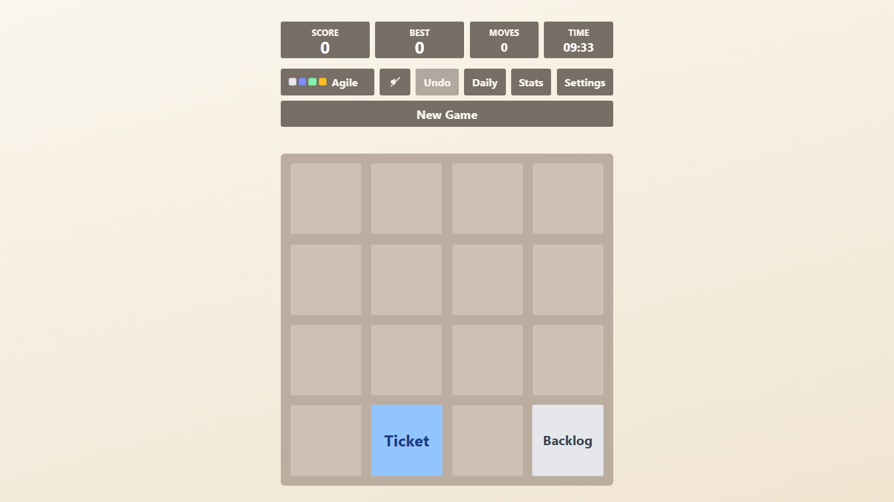
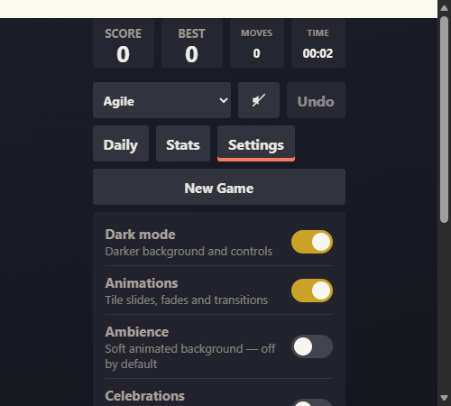
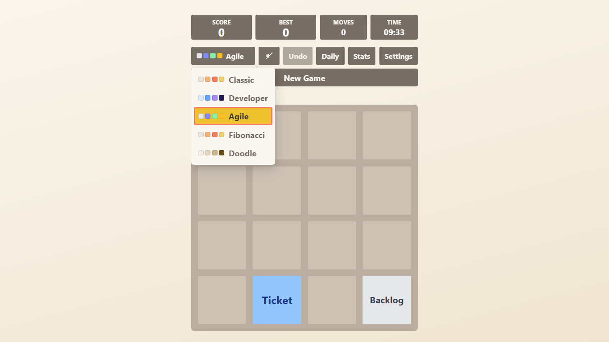
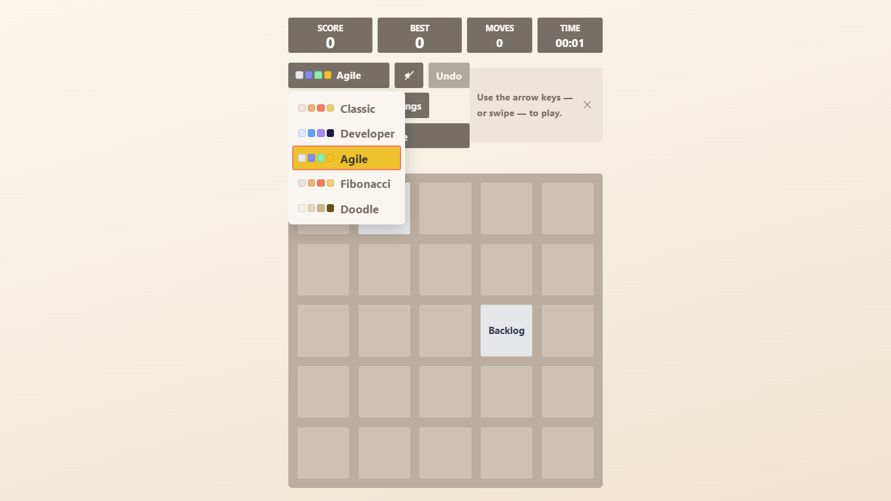
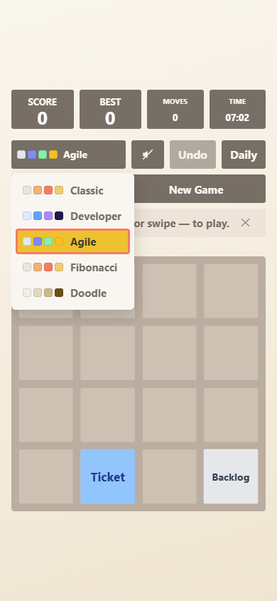

# 2048-clone

**Play online:** https://daniilperkin.github.io/2048-clone/ — works on phone and desktop.

A modernized fork of [2048](https://github.com/gabrielecirulli/2048), originally based on [1024](https://play.google.com/store/apps/details?id=com.veewo.a1024) and [Saming's 2048](http://saming.fr/p/2048/), indirectly inspired by [Threes](https://asherv.com/threes/).

## What's different

This fork modernizes the original game with:

- **ES6+ code** — classes, `const`/`let`, arrow functions, template literals
- **Theme system** — five built-in themes (Classic, Developer, Agile, Fibonacci, Doodle) with custom tile labels, colors, and win thresholds. Themes are selectable at runtime and persisted to `localStorage`.
- **Accessibility** — ARIA grid roles, `aria-live` for game messages, `:focus-visible` styles; the UI is checked against WCAG 2.1 AA with `vitest-axe` in CI
- **Single-file bundling** — `node build-bundle.js` produces a standalone `2048.html` with all JS and CSS inlined, for embedding as an easter egg in other projects (the page shell is extracted from `index.html` at build time, so it can never drift from the real markup)
- **ESLint 10 + Prettier 3** — modern flat config linting and formatting
- **Undo** — take back up to 10 moves (button, **U** or **Ctrl/Cmd+Z**); history survives a reload
- **Daily Challenge** — one seeded board per local calendar day, identical for every player on the same date, with its own best score
- **Stats panel** — lifetime games played/won, win rate, best tile and best win streak, with undo-aware bookkeeping (a taken-back ending move is not counted)
- **Shareable results** — after a win or a loss, one click copies the score, best tile and an emoji board to the clipboard
- **Installable & offline** — a web app manifest and service worker make the served build installable as a PWA and playable offline after the first visit (the standalone bundle is already offline by construction)
- **Appearance options** — dark mode, subtle per-theme gradient backgrounds and an opt-in animated ambience layer, all behind one Settings panel; every visual effect is off until you turn it on
- **Moves counter & timer** — live move count and elapsed play time per game, frozen while an end overlay shows, resumed by "Keep going", and persisted with the save
- **Optional celebrations** — confetti on a win and a soft glow on a loss, opt-in from Settings
- **Board sizes** — 3×3, 4×4 and 5×5 from the Settings panel; every size keeps its own save, best score and records
- **Local records** — a top-5 leaderboard per mode and a daily-participation streak in the Stats panel
- **Three-state dark mode** (off / on / auto, following the OS) and an opt-in colour-blind tile-pattern mode
- **Vitest test suite** — 250+ tests covering game logic, input, rendering, storage, sound, themes, the seeded RNG, the PWA shell, preferences and accessibility; CI enforces coverage thresholds and runs a Chromium smoke test
- **Namespaced localStorage** — keys are prefixed with `2048-` to avoid collisions on host pages

## Screenshots

| Desktop (Classic)                                       | Dark mode + Settings                                            |
| ------------------------------------------------------- | --------------------------------------------------------------- |
|  |  |

| Theme picker                                 | 5×5 board                                    | Mobile                                        |
| -------------------------------------------- | -------------------------------------------- | --------------------------------------------- |
|  |  |  |

## Playing

```bash
npm install
npm start
```

Then open http://localhost:8080 in your browser.

The served page is installable as a PWA (browser install button in the address bar) and keeps working offline after the first visit.

### Controls

- **Arrow keys** / **WASD** / **Vim keys (hjkl)** — move tiles
- **R** — restart the game
- **U** / **Ctrl+Z** / **Cmd+Z** — undo the last move
- **Touch swipes** — move tiles on mobile devices
- **Share** — after a win or a game over, copy the result (score, best tile, emoji board)
- **Settings** — dark mode (off / on / auto), board size, animations, ambience, tile patterns and celebrations (all persisted)
- **Theme picker** — the selector previews each theme's tile colours as swatches

### Themes

Use the theme selector at the top of the page. Each theme has unique tile labels and a different win threshold:

| Theme     | Win Threshold | Tile Labels                           |
| --------- | ------------- | ------------------------------------- |
| Classic   | 2048          | Numbers (2, 4, 8, … 2048)             |
| Developer | 64            | Intern → Junior → … → Principal       |
| Agile     | 128           | Backlog → Ticket → … → Deployed       |
| Fibonacci | 128           | Fibonacci sequence (1, 2, 3, 5, … 21) |
| Doodle    | 2048          | Numbers on hand-drawn SVG tile art    |

Tiles past the last defined label get a roman-numeral suffix (e.g. "Deployed ii", "Deployed iii").

Each theme also has its own subtle background gradient, and dark mode (Settings → Dark mode) re-skins the page chrome while tiles keep their theme colors — Doodle gets a dark paper stock of its own.

## Building the single-file bundle

```bash
node build-bundle.js
```

This produces `2048.html` — a standalone file with all JavaScript and CSS inlined (Doodle tile SVGs embedded as data URIs; the build runs `tools/generate-tiles.mjs` first). The file is gitignored and should be regenerated at deploy time.

## Releasing

Tag a commit to publish the single-file bundle:

```bash
git tag v1.0.0
git push origin v1.0.0
```

The Release workflow re-runs the full gate, builds `2048.html` and attaches it to a GitHub Release, so the gitignored bundle stays downloadable without a local build.

## Development

### Prerequisites

- Node.js 22.22.2+ (LTS recommended — required by the jsdom test environment)
- npm

### Setup

```bash
npm install
```

### Available scripts

| Script                 | Description                                 |
| ---------------------- | ------------------------------------------- |
| `npm start`            | Generate tile art, then serve on 8080       |
| `npm run tiles`        | Generate Doodle tile SVGs in `build/`       |
| `npm run icons`        | Regenerate the PWA icons in `meta/`         |
| `npm run build`        | Generate the single-file `2048.html`        |
| `npm run lint`         | Run ESLint                                  |
| `npm run lint:fix`     | Run ESLint with auto-fix                    |
| `npm run format`       | Format all files with Prettier              |
| `npm run format:check` | Check formatting without writing            |
| `npm test`             | Run the Vitest test suite                   |
| `npm run coverage`     | Run tests with the coverage thresholds      |
| `npm run typecheck`    | Type-check the plain-JS sources (tsc)       |
| `npm run test:e2e`     | Run the Playwright browser smoke test       |
| `npm run verify`       | format + lint + css + types + tests + build |

### Project structure

```
2048-clone/
├── index.html              # Dev entry — loads 16 separate <script> tags
├── manifest.webmanifest    # PWA install metadata
├── sw.js                   # Service worker: offline shell (guarded by test/pwa.test.js)
├── build-bundle.js         # Single-file bundler (shell extracted from index.html)
├── config/                 # Tool configs (scripts pass explicit --config paths)
│   ├── eslint.config.js    # ESLint 10 flat config
│   ├── vitest.config.js    # Vitest + jsdom (root pinned one level up)
│   ├── playwright.config.js# Browser smoke suite (test/e2e, port 8090)
│   ├── jsconfig.json       # tsc checkJs config for the plain-JS sources
│   ├── .prettierrc.json    # Prettier 3
│   ├── .prettierignore
│   └── .stylelintrc.json   # stylelint (recommended config)
├── js/                     # Game source (plain scripts, shared global scope)
│   ├── directions.js       # Shared direction contract (UP/RIGHT/DOWN/LEFT)
│   ├── themes.js           # ThemeManager + 5 theme definitions
│   ├── keyboard_input_manager.js
│   ├── random.js           # SeededRandom (mulberry32) for the Daily Challenge
│   ├── grid.js             # Grid model
│   ├── tile.js             # Tile value object
│   ├── local_storage_manager.js
│   ├── stats.js            # StatsTracker (lifetime stats, undo-aware)
│   ├── share.js            # ShareResult (emoji-board summary + clipboard)
│   ├── records.js          # Leaderboard (top-5 per mode) + DailyStreak
│   ├── preferences.js      # Dark mode / motion / ambience / patterns / celebration flags
│   ├── sound_manager.js    # Opt-in Web Audio merge/win/lose sounds
│   ├── view_transitions.js # View Transitions API wrapper
│   ├── html_actuator.js    # DOM renderer
│   ├── game_manager.js     # Controller: move/merge/win/lose logic
│   └── application.js      # Bootstrap (+ service worker registration)
├── style/                  # main.css (hand-maintained)
├── test/                   # Vitest + jsdom suite (incl. axe a11y + PWA drift guards)
├── tools/                  # generate-tiles.mjs — Doodle SVG art → build/tiles/ (gitignored)
│                           # make-icons.mjs — PWA icons → meta/icon-*.png (committed)
├── docs/screenshots/       # README screenshots
└── .github/                # workflows/ (ci.yml gate + release.yml tag → Release) and CONTRIBUTING.md
```

## Credits

Original game by [Gabriele Cirulli](https://github.com/gabrielecirulli). See the upstream [repository](https://github.com/gabrielecirulli/2048) for the full contributor list.

## License

MIT — see [LICENSE.txt](LICENSE.txt).
